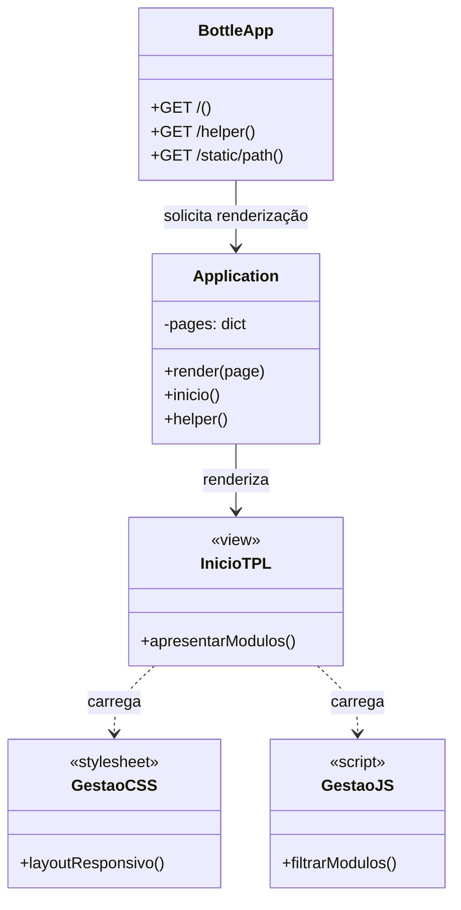
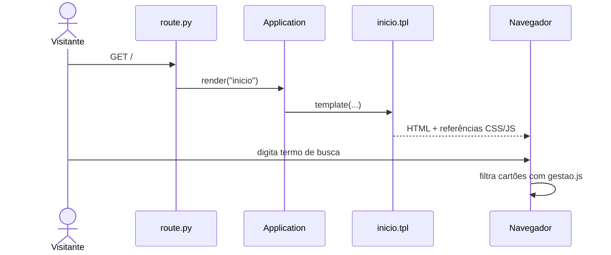

# UML — Nível 1: página estática

O primeiro nível não possui entidades persistidas. O diagrama representa a colaboração entre a rota Bottle, o controlador BMVC, o template e os arquivos estáticos.

## Leitura do diagrama

- `BottleApp` representa as funções de rota de `route.py`.
- `Application` é uma classe Python real e atua como controlador.
- Os três elementos com estereótipos representam arquivos e responsabilidades da interface, não classes Python.
- A rota chama o controlador, o controlador renderiza a view e a view carrega CSS e JavaScript.

## Fluxo principal

O diagrama de sequência mostra a ordem temporal: a requisição HTTP é processada no servidor, enquanto o filtro ocorre depois no navegador, sem uma nova requisição.
