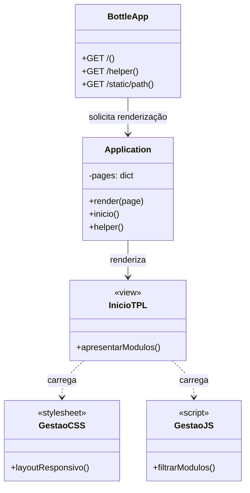
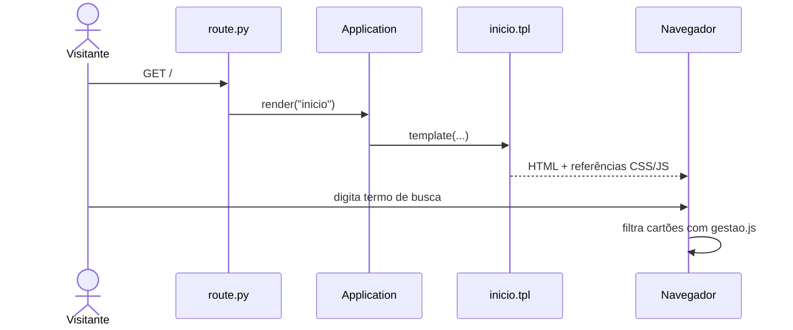

# UML — Nível 1: página estática

O primeiro nível ainda não possui entidades de negócio persistidas. O diagrama mostra a colaboração entre a rota Bottle, o controlador BMVC, o template e os arquivos estáticos.

Fluxo principal:

