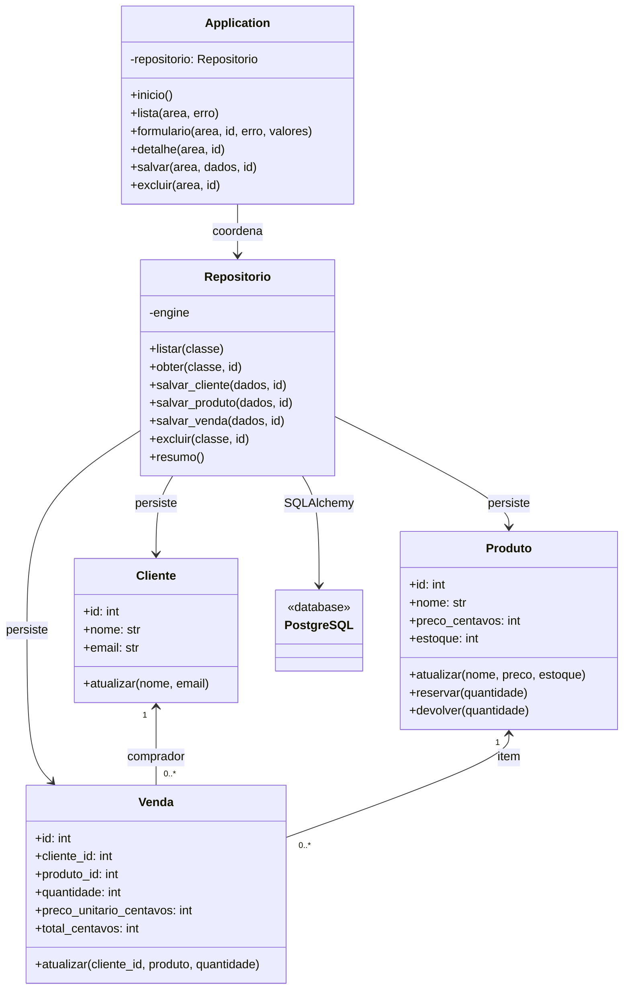
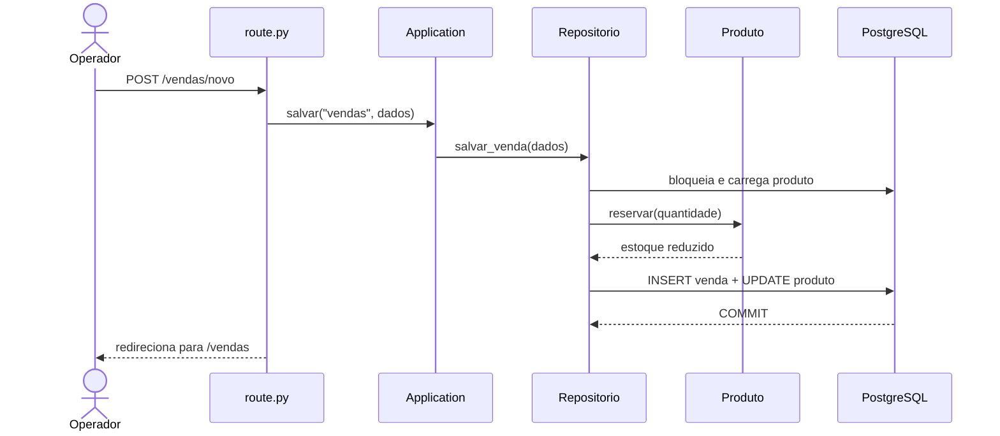

# UML — Nível 2: CRUD com PostgreSQL

O segundo nível acrescenta objetos de domínio e persistência SQLAlchemy. `Venda` liga um `Cliente` a um `Produto` e preserva o preço unitário usado no registro.

## Leitura do diagrama

`Application` não executa SQL diretamente. Ela solicita operações ao `Repositorio`, que abre a transação e persiste os objetos. As associações indicam que cada venda referencia exatamente um cliente e um produto, enquanto ambos podem possuir várias vendas.

## Transação de uma venda

O bloqueio evita que duas operações concorrentes vendam as mesmas últimas unidades. O `COMMIT` garante que venda e estoque sejam confirmados juntos.
