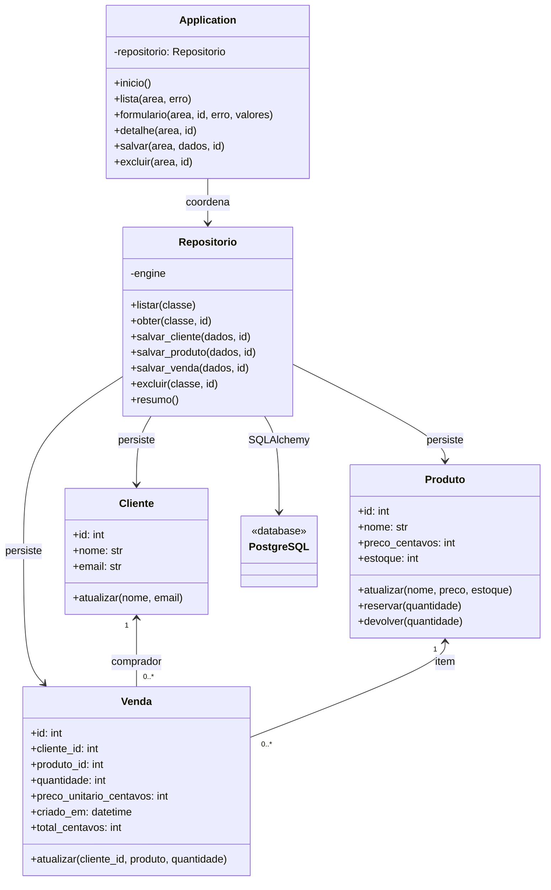
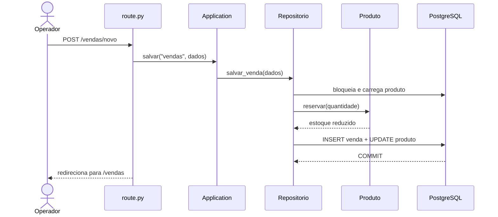

# UML — Nível 2: CRUD com PostgreSQL

O segundo nível acrescenta os objetos de domínio e a persistência SQLAlchemy. `Venda` liga um `Cliente` a um `Produto` e preserva o preço unitário utilizado no momento do registro.

Transação de uma nova venda:

