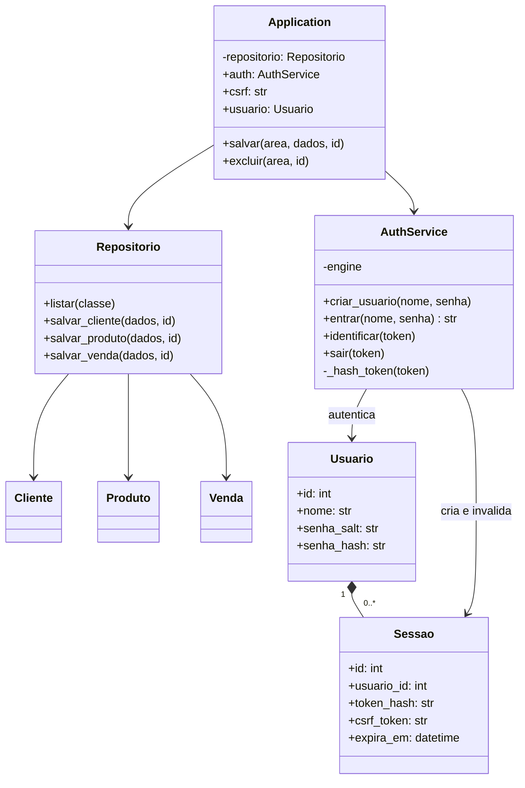
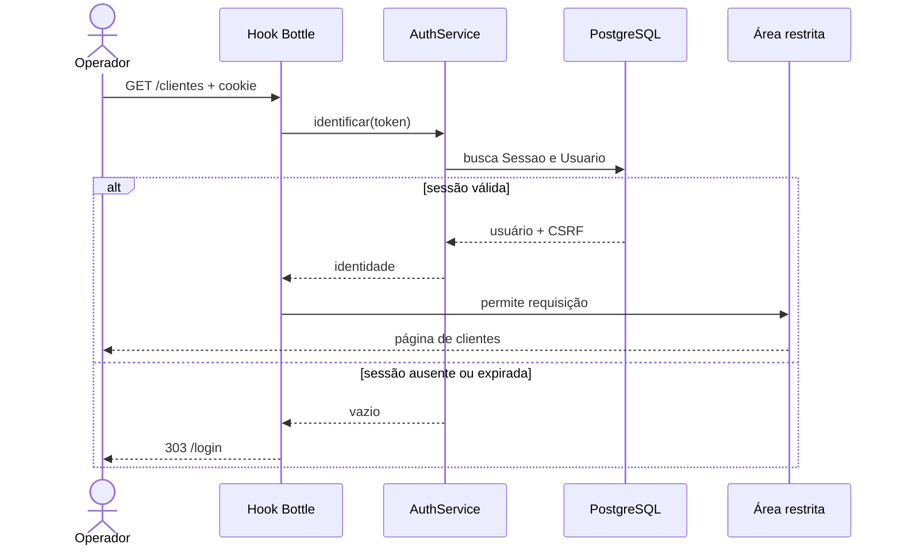

# UML — Nível 3: autenticação e área restrita

O terceiro nível mantém as classes comerciais e acrescenta `Usuario`, `Sessao` e `AuthService`. A senha é representada por salt e hash; a sessão armazena o hash do token e um token CSRF.

## Leitura do diagrama

O losango preenchido em `Usuario *-- Sessao` representa composição: a sessão pertence a um usuário. O `AuthService` concentra segurança e ciclo de vida da sessão; o `Repositorio` continua responsável pelo domínio comercial.

## Fluxo de acesso protegido

O bloco `alt` representa caminhos alternativos. Somente o caminho de sessão válida chega à área restrita; o outro termina no redirecionamento ao login.
