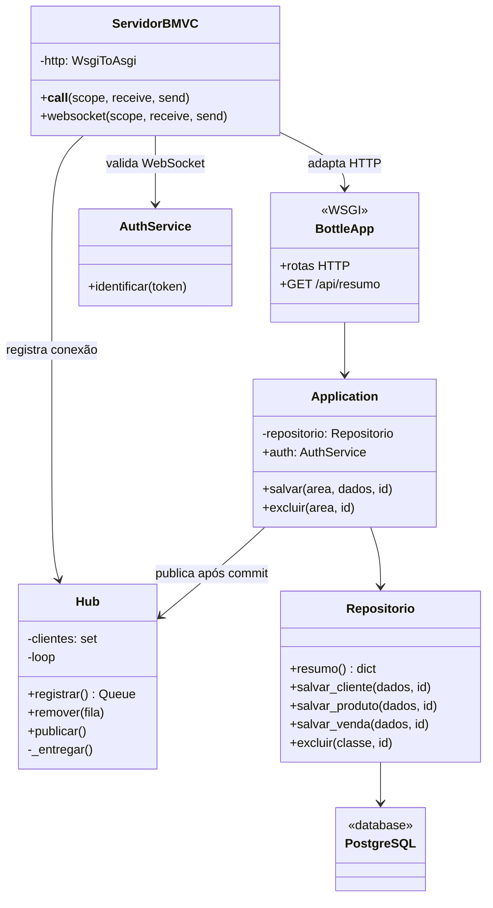
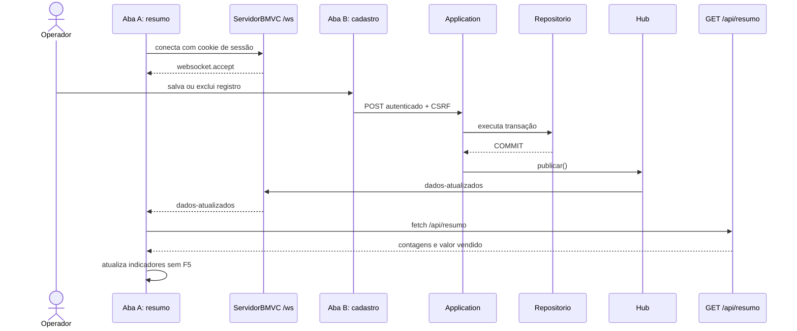

# UML — Nível 4: atualização por WebSocket

O quarto nível mantém o CRUD e a autenticação. `ServidorBMVC` adapta o Bottle para HTTP e atende `/ws`; `Hub` registra conexões e distribui avisos após alterações confirmadas no banco.

Atualização do resumo em duas abas:

